<p align="center">
  
</p>

<h1 align="center">Fengard</h1>

<p align="center">
  <b>Kernel-enforced firewall and DNS filtering for any OpenWrt router.</b><br>
  One Go binary. Per-device profiles, screen time, a WireGuard VPN and a full dashboard.<br>
  Installs next to your router's firmware with one double-click. Nothing gets reflashed.
</p>

<p align="center">
  Parental controls, ad blocking and screen time for every device on your home network,
  running on the router itself: OpenWrt, GL.iNet and other OpenWrt-based routers.
  A self-hosted alternative to Pi-hole and AdGuard Home that kids can't get around by changing DNS.
</p>

<p align="center">
  <a href="https://github.com/masaleem-oss/Fengard/actions/workflows/ci.yml"></a>
  <a href="LICENSE"></a>
  
  
  
  
</p>

<p align="center">
  <a href="#install">Install</a> ·
  <a href="#screenshots">Screenshots</a> ·
  <a href="docs/how-it-works.md#how-it-works">How it works</a> ·
  <a href="#features">Features</a> ·
  <a href="docs/configuration.md#configuration-reference">Reference</a> ·
  <a href="docs/development.md#development">Development</a>
</p>

<p align="center">
  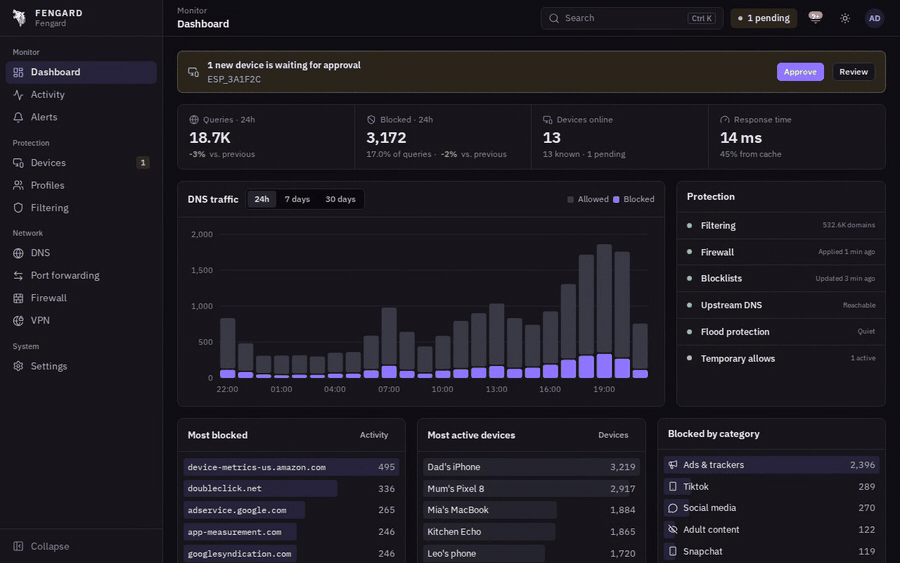
</p>

---

## Contents

- [Why Fengard](#why-fengard)
- [How it compares](#how-it-compares)
  - [Memory](#memory)
- [Install](#install)
  - [Which routers work](#which-routers-work)
  - [Supported routers](docs/routers.md#supported-routers)
  - [What the installer changes](docs/how-it-works.md#what-the-installer-changes)
  - [Running on a computer instead](#running-on-a-computer-instead)
  - [Uninstall](#uninstall)
- [Screenshots](#screenshots)
- [How it works](docs/how-it-works.md#how-it-works)
- [Features](#features)
- [Performance](docs/how-it-works.md#performance)
- [Configuration reference](docs/configuration.md#configuration-reference)
- [Security](docs/how-it-works.md#security)
- [Troubleshooting](#troubleshooting)
- [FAQ](#faq)
- [Development](docs/development.md#development)
- [Project layout](docs/development.md#project-layout)
- [Contributing](#contributing)
- [License](#license)
- [Star goals](#star-goals)

## Why Fengard

Most home filtering is either a DNS server on a Raspberry Pi, which any device can route around, or a
subscription box that replaces your router. Fengard does it on the router you already have:

- **It can't be bypassed by changing DNS.** Lookups sent to any other server are redirected back to Fengard,
  and DNS-over-HTTPS, DNS-over-TLS, DNS-over-QUIC and Tor are blocked in the kernel.
- **Every device gets its own rules.** Profiles carry blocked categories, blocked apps, SafeSearch,
  schedules and daily screen-time limits, and a person's limit is counted across all their devices.
- **The kernel does the work.** Filtering decisions live in nftables or iptables rules in Fengard's own
  table. If Fengard stops, it removes them and the router carries on as a normal router.
- **It stays out of your way.** It runs next to the stock firmware, installs and uninstalls in one step,
  and uses about 25 MB of memory.

## How it compares

Pi-hole and AdGuard Home are great DNS blockers. Fengard covers the same ground and adds the parts a family
network needs, enforced by the router's firewall:

| | Fengard | Pi-hole | AdGuard Home |
|---|:---:|:---:|:---:|
| Network-wide ad and tracker blocking | ✅ | ✅ | ✅ |
| Per-device profiles | ✅ | ✅ groups | ✅ per client |
| Runs on the router itself | ✅ any OpenWrt router | ❌ needs a separate machine | ✅ |
| Stops devices using another DNS server, DoH or DoT | ✅ in the kernel | ❌ needs your own firewall rules | ❌ needs your own firewall rules |
| Encrypted upstream DNS | ✅ DoT, DoH, DoH over HTTP/3 | ❌ needs a separate proxy | ✅ DoT, DoH, DoQ, HTTP/3 |
| Daily screen-time limits per person, across their devices | ✅ | ❌ | ❌ |
| Block single apps (TikTok, Roblox, Fortnite...) | ✅ | lists only | ✅ |
| Block page with a "request access" button | ✅ | ❌ | ❌ |
| Built-in WireGuard VPN with the same filtering on mobile data | ✅ | ❌ | ❌ |
| Port forwarding and WAN hardening | ✅ | ❌ | ❌ |
| One-click install and clean uninstall | ✅ | ✅ | ✅ |

<sub>Based on each project's out-of-the-box features. Pi-hole and AdGuard Home can do more with extra setup.</sub>

### Memory

Routers don't have much of it, so this matters more than speed. With the same seven blocklists (534k domains),
started cold side by side:

<picture>
  <source media="(prefers-color-scheme: dark)" srcset="docs/memory-dark.svg">
  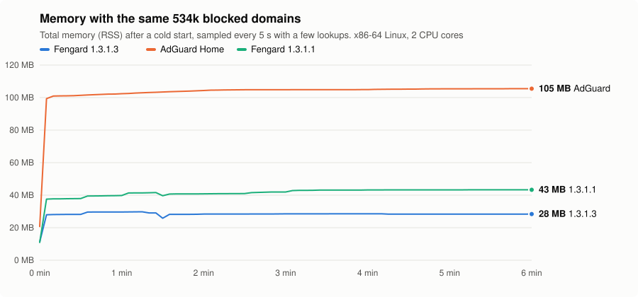
</picture>

Fengard 1.3.1.3 settles at about 28 MB, AdGuard Home 0.107.79 at about 105 MB with its default settings. This was
measured on a PC (x86-64 Linux, each program on 2 cores) so all three ran under the same conditions. A real
router will show somewhat different numbers; Fengard 1.3.1.3 uses about 33 MB on a GL-MT3000 with these lists.
[`dev/memcompare`](dev/memcompare) has the script to run it yourself.

## Install

Download **`fengard-<version>.zip`** from the [latest release](https://github.com/masaleem-oss/Fengard/releases/latest),
unzip it, and run the installer:

| On | Run |
|---|---|
| Windows | Double-click **`Install Fengard.cmd`** |
| macOS or Linux | `sh install.sh` in the unzipped folder |

Both open the same menu:

```
Fengard setup

  1  Install on my router        OpenWrt-based routers, including GL.iNet (recommended)
  2  Run on this computer        protects the whole network through DNS; this computer stays on
  3  Remove from my router
  4  Remove from this computer
```

Choose **1**. The installer finds your router, asks for its root password (on most routers that's the admin
page password), and does everything else. When it finishes it prints the dashboard address, usually
**http://fengard.lan**. Open it and create the admin account.

If AdGuard Home is using DNS port 53, the installer asks whether to turn it off so Fengard can take over.
Removing Fengard turns it back on.

<a href="docs/videos/install-script.mp4">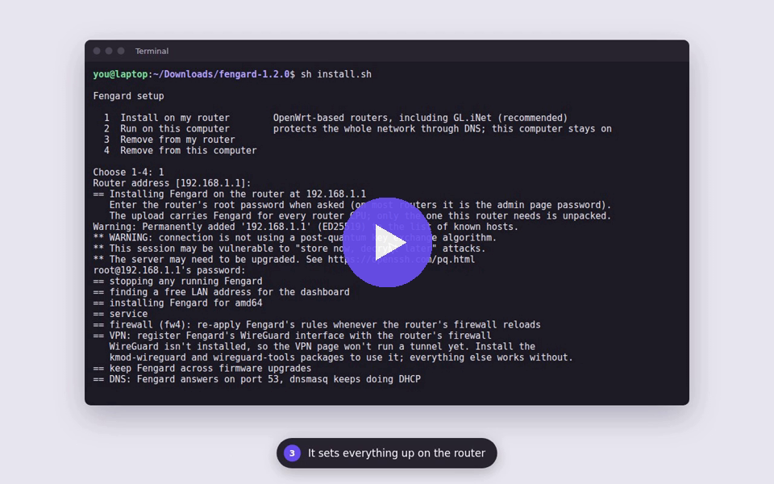</a>

> Windows may warn about a downloaded file. Choose **More info → Run anyway**, or right-click the zip,
> open **Properties** and tick **Unblock** before unzipping.

**Without a computer.** A router with internet access can install straight from the latest release over SSH:

```sh
wget -O- https://github.com/masaleem-oss/Fengard/releases/latest/download/router-install.sh | sh
```

**From the router's web page (LuCI).** Every release has a package for each CPU type:
`fengard_<version>_<cpu>.ipk` for OpenWrt up to 24.10 (and GL.iNet), `.apk` for OpenWrt 25.12 and later.
The CPU names match the [Supported routers](docs/routers.md#supported-routers) table, for example `arm64` for a GL-MT3000 or
`mipsle` for an MT7621 router.

1. In LuCI open **System → Software**, choose **Upload Package…** and pick the `.ipk`.
2. It sets itself up in about a minute, the same way the installer does. Log out of LuCI and back in, then open
   **Services → Fengard** to see how it went, start or stop it, and open the dashboard.

<a href="docs/videos/install-luci.mp4">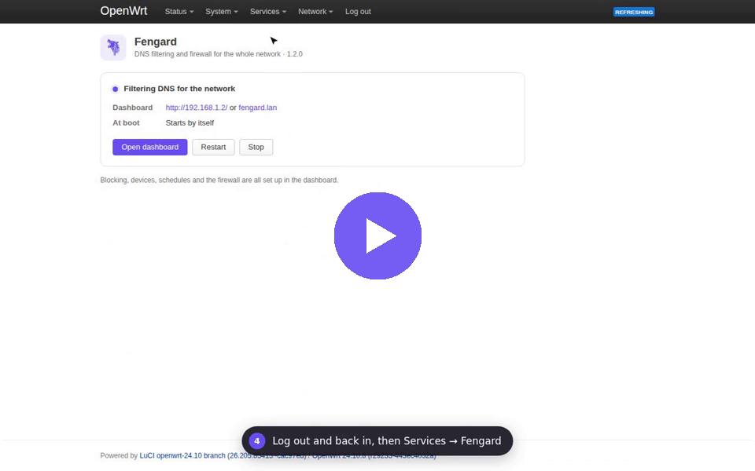</a>

On GL.iNet firmware, LuCI is under **System → Advanced Settings** in the GL admin panel. If you pick the
package for the wrong CPU, it says so and leaves the router as it was.

> **OpenWrt 25.12 and later: the LuCI upload doesn't work.** 25.12 moved to the `apk` package manager, which
> only installs packages signed by a key the router already trusts. LuCI's upload page has no way to allow
> anything else, and there's no way to add a trusted key from LuCI either, so it refuses every package that
> isn't from OpenWrt itself, Fengard included. Signing Fengard's packages wouldn't change that, because the
> router would still need Fengard's key put on it over SSH first. On 25.12 use the one-line install above, or
> install the `.apk` over SSH:

Copy it to the router (`scp -O fengard_<version>_<cpu>.apk root@192.168.1.1:/tmp/`), then run:

```sh
apk add --allow-untrusted /tmp/fengard_<version>_<cpu>.apk
```

The Services → Fengard page works the same after that.

### Which routers work

Fengard needs **OpenWrt-based firmware with SSH access**.

| Works | Doesn't work |
|---|---|
| OpenWrt 19.07 and newer, on any brand | Stock ISP routers |
| GL.iNet (its firmware is OpenWrt-based) | Eero, Google and Nest Wifi |
| Turris and other OpenWrt-based firmware | Most stock TP-Link, Asus and Netgear firmware |

If your router is in the right-hand column, use [computer mode](#running-on-a-computer-instead), or flash
OpenWrt if your model supports it.

| Requirement | Minimum |
|---|---|
| RAM | 128 MB (256 MB or more is comfortable) |
| Free storage | about 30 MB, or USB storage with `FG_DIR=/mnt/<usb>/fengard` |
| CPU | ARM64, ARMv5 and up, MIPS and MIPSEL (32 and 64-bit), x86-64, x86, RISC-V 64, LoongArch64 |

The installer checks memory and storage first and stops cleanly if the router is too small.

### Supported routers

Every release is installed on 13 emulated routers, covering ARM64, ARMv7, MIPS, MIPS64 and x86 on
OpenWrt 19.07 to 25.12, before it ships. See [the router lab results](docs/routers.md) for every router type,
the checks each one passes and how much memory Fengard uses on it.

#### When things go wrong

Power cuts mid-install, a full flash, too little memory, another DNS server on port 53, AdGuard Home,
firmware upgrades, a crashing program and GL.iNet quirks are all tested too, and the house keeps DNS in
every one of them. See [When things go wrong](docs/routers.md#when-things-go-wrong).

### What the installer changes

It reads everything from the router's own configuration: an alias address for the dashboard, port 53
for DNS, a firewall include and the WireGuard interface. Every change is recorded and undone on uninstall.
See [what the installer changes](docs/how-it-works.md#what-the-installer-changes).

### Running on a computer instead

For routers that can't run Fengard, option 2 runs it on an always-on computer as a background service:

| System | Runs as | Program | Data |
|---|---|---|---|
| Windows | scheduled task | `C:\Program Files\Fengard` | `C:\ProgramData\Fengard` |
| macOS | launchd daemon | `/usr/local/fengard` | `/Library/Application Support/Fengard` |
| Linux, Raspberry Pi | systemd service | `/usr/local/bin/fengardd` | `/var/lib/fengard` |

It opens the local network through the computer's firewall (Windows Firewall, the macOS firewall, ufw or
firewalld) and then tells you the one step left: set your router's DHCP DNS server to this computer.

Computer mode filters every device by DNS but has limits:

- **No firewall.** Port forwards, bypass blocking, flood limits and the VPN need the router install.
- **The computer must stay on and awake.** While it sleeps, devices lose name lookups.
- **Its address must not change.** Reserve it in the router's DHCP settings.
- **Only one DNS server.** Give devices no second DNS server, or they can go around Fengard.

### Uninstall

- **Router:** option 3 in the menu, or `sh /etc/fengard/uninstall.sh` on the router. Add `--purge` to also delete
  settings and history. If you installed the package, removing `fengard` in **System → Software** (or
  `opkg remove fengard`, `apk del fengard`) does the same, keeping settings for a reinstall.
- **Computer:** option 4 in the menu. Then set your router's DHCP DNS server back to automatic.

## Screenshots

<p align="center">
  <picture>
    <source media="(prefers-color-scheme: light)" srcset="docs/screenshots/dashboard-light.png">
    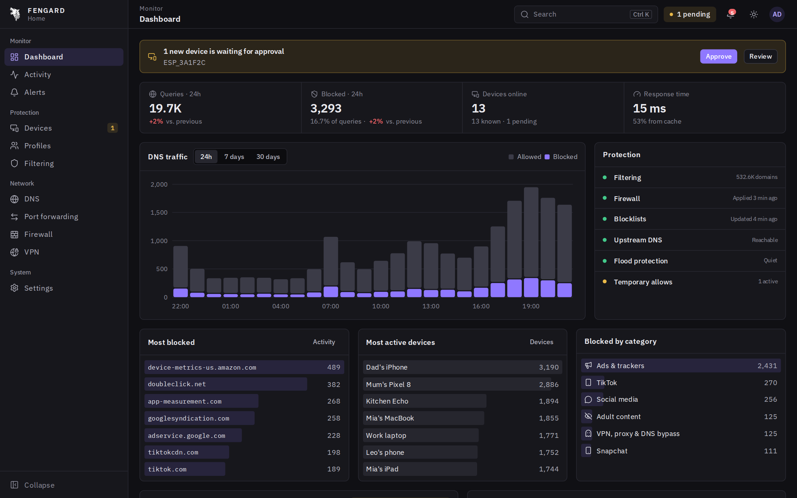
  </picture>
  <br><sub>The dashboard follows your GitHub theme: dark or light, same as the real one.</sub>
</p>

<table>
  <tr>
    <td width="50%">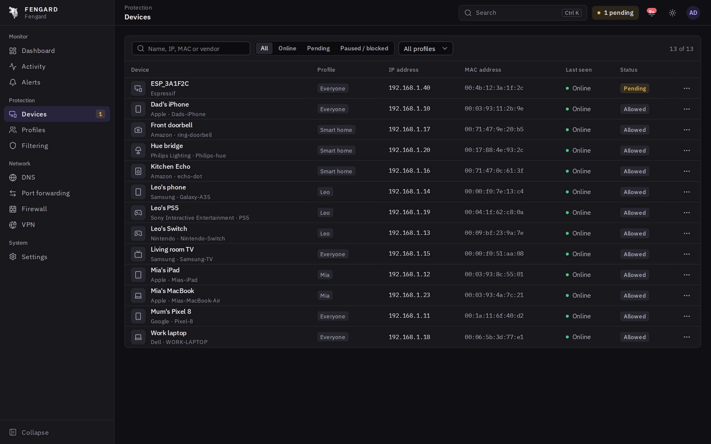<br><b>Devices.</b> Found automatically, with the manufacturer from the MAC address.</td>
    <td width="50%">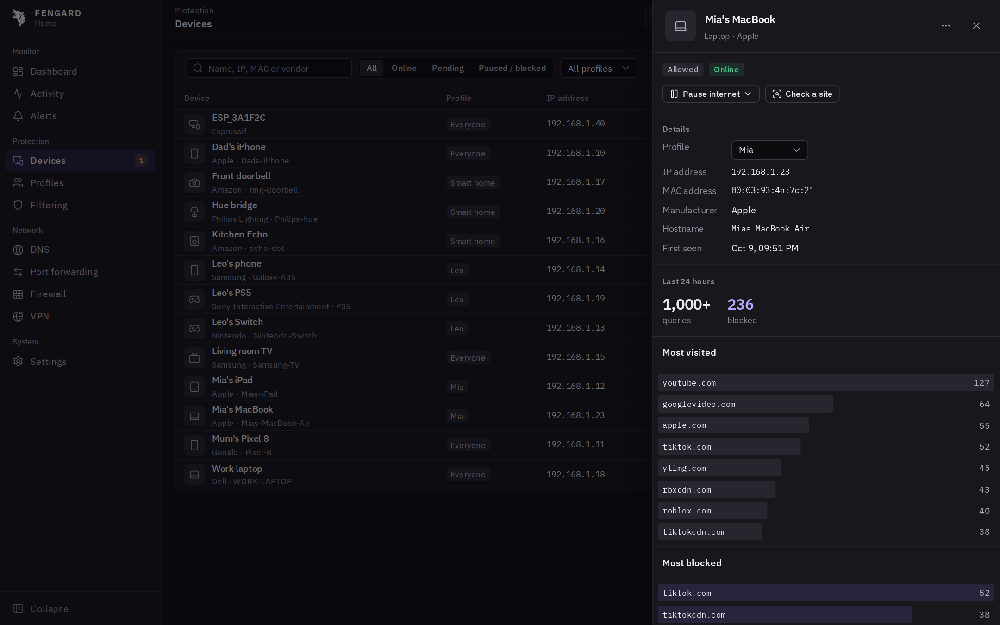<br><b>One device.</b> Its activity, top sites, profile, pause and Wake-on-LAN.</td>
  </tr>
  <tr>
    <td>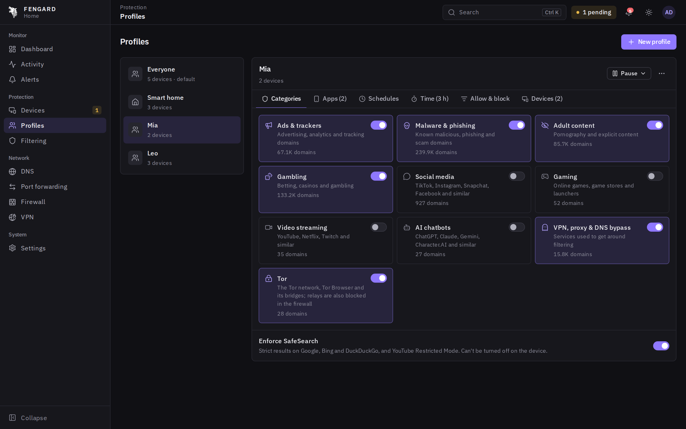<br><b>Profiles.</b> Categories, apps, SafeSearch, schedules and screen time per person.</td>
    <td>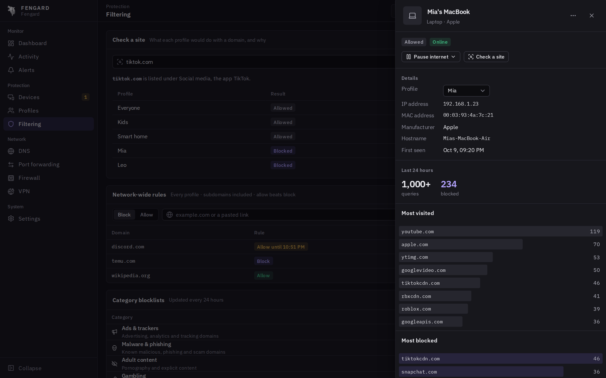<br><b>Check a site.</b> What every profile would do with a domain, and why.</td>
  </tr>
  <tr>
    <td>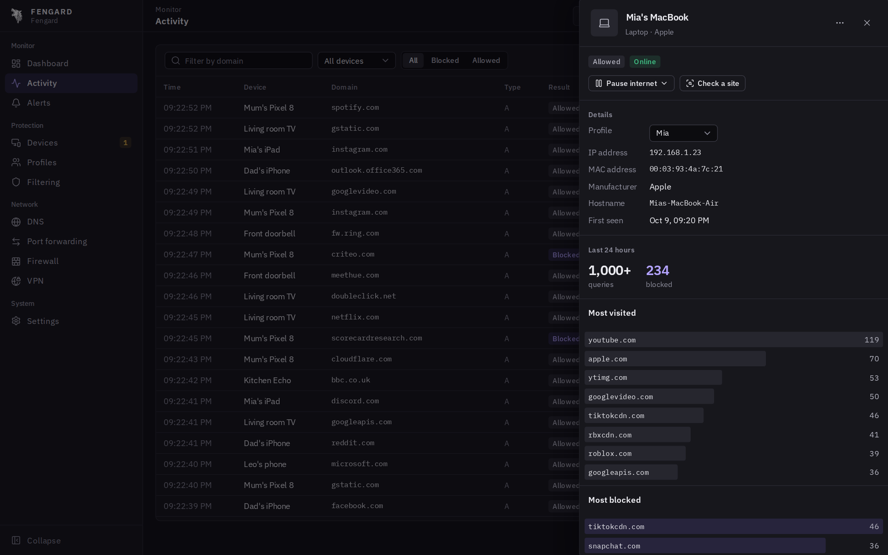<br><b>Activity.</b> Every lookup, live or historical, filtered by device or domain.</td>
    <td>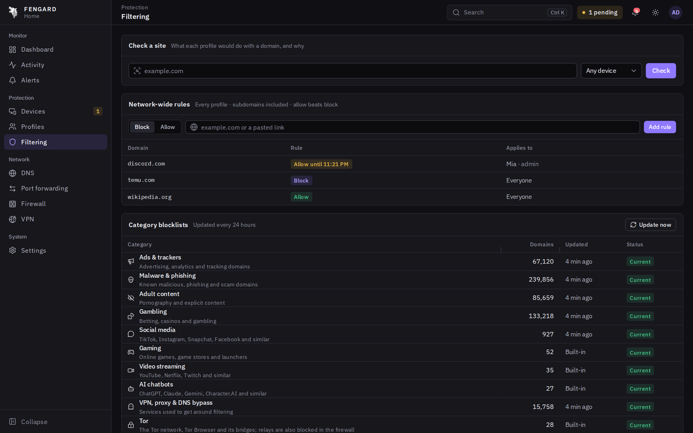<br><b>Filtering.</b> Categories, block and allow rules, temporary allows and custom lists.</td>
  </tr>
  <tr>
    <td>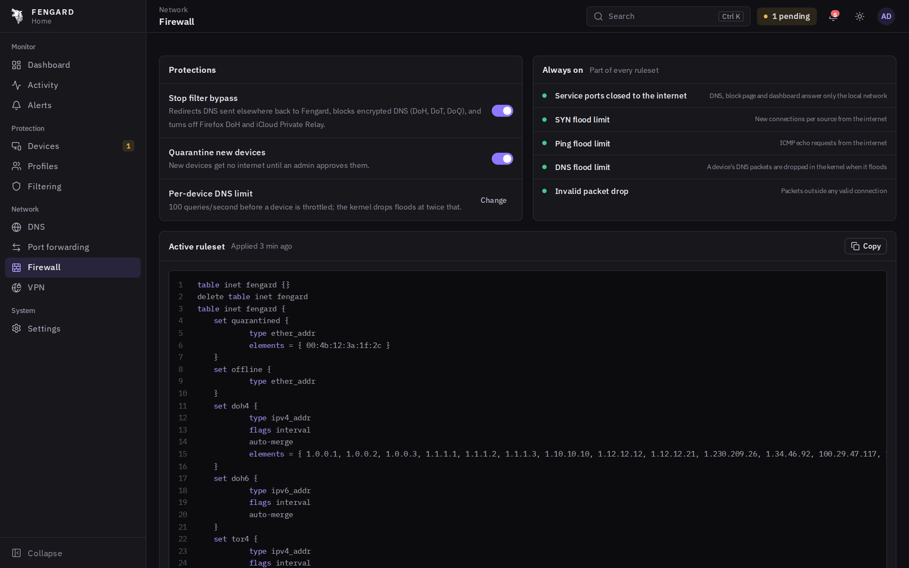<br><b>Firewall.</b> Bypass blocking, quarantine and WAN hardening, with the live ruleset.</td>
    <td>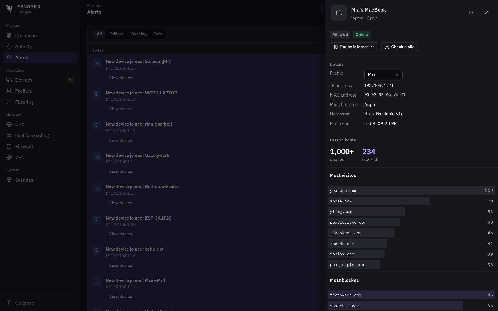<br><b>Alerts.</b> New devices, access requests, limits and upstream problems.</td>
  </tr>
  <tr>
    <td>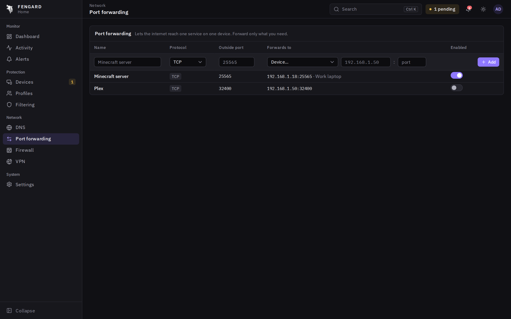<br><b>Port forwarding.</b> Open a port to one device, enforced in the kernel.</td>
    <td>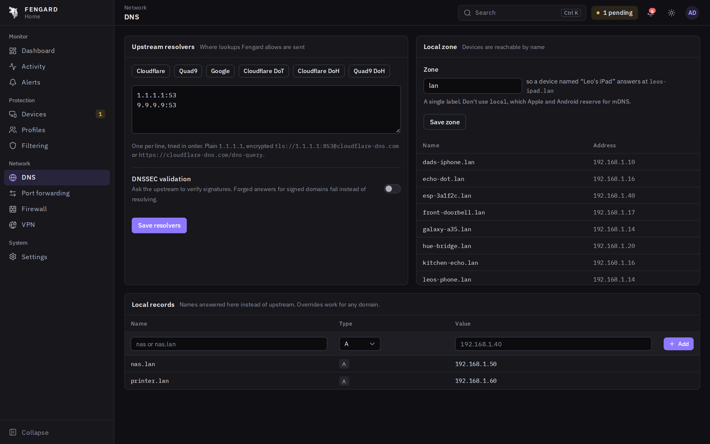<br><b>DNS.</b> Plain, DoT, DoH or HTTP/3 upstreams, DNSSEC and <code>.lan</code> records.</td>
  </tr>
  <tr>
    <td>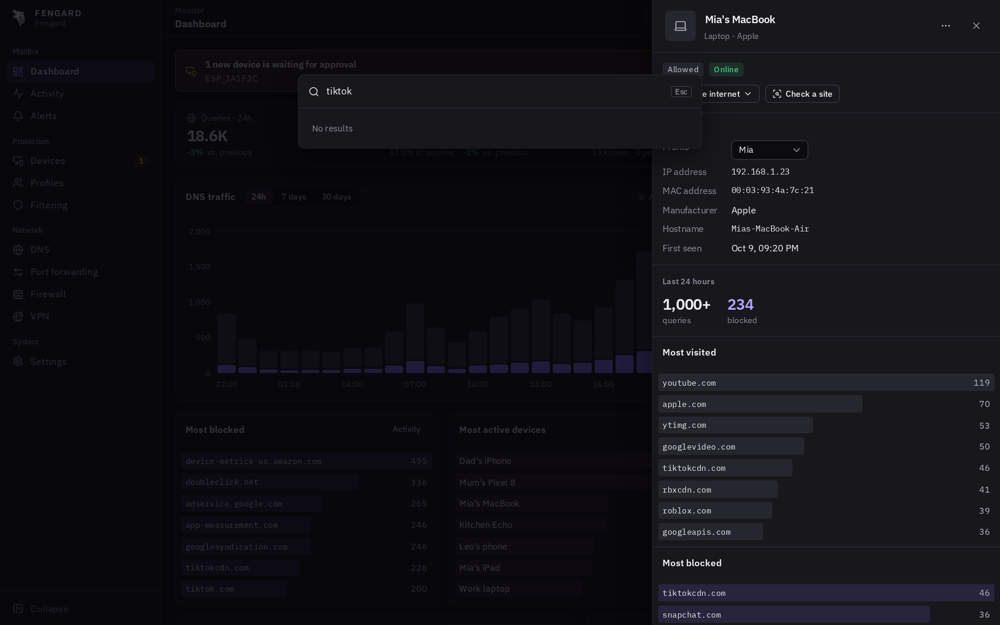<br><b>Command palette.</b> <kbd>Ctrl</kbd> <kbd>K</kbd> jumps to pages, devices or a site check.</td>
    <td>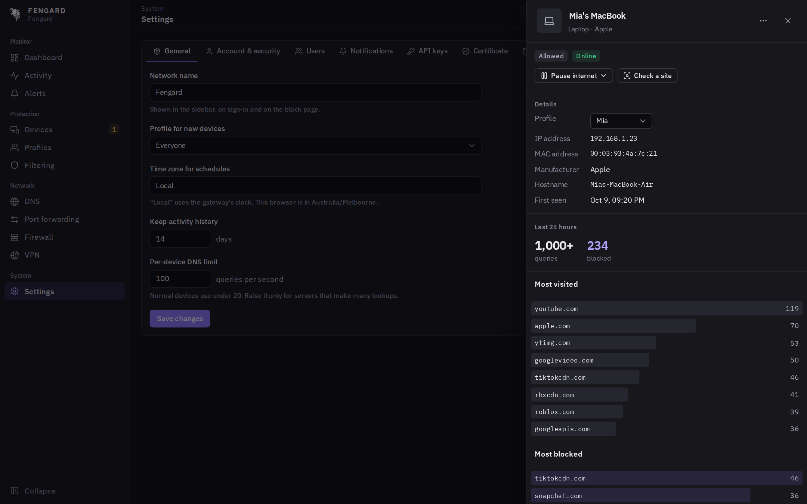<br><b>Settings.</b> Accounts, two-factor, notifications, API keys, backups and history.</td>
  </tr>
</table>

What a device on the network sees:

<table>
  <tr>
    <td width="33%" align="center">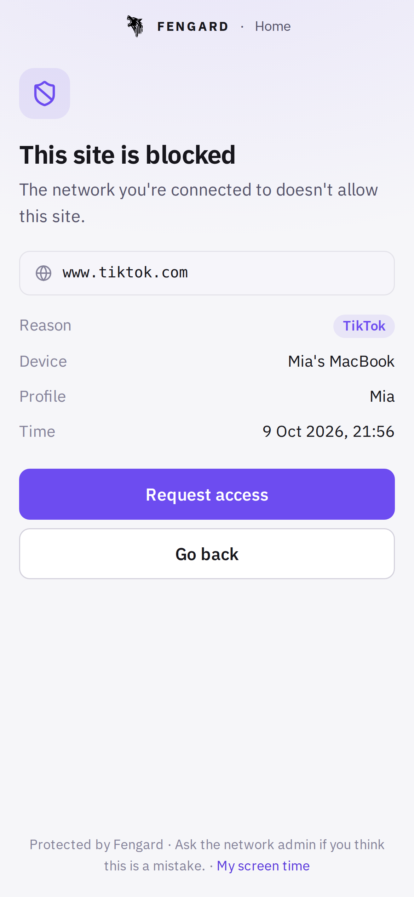<br><b>Block page</b> with the reason and a request-access form.</td>
    <td width="33%" align="center">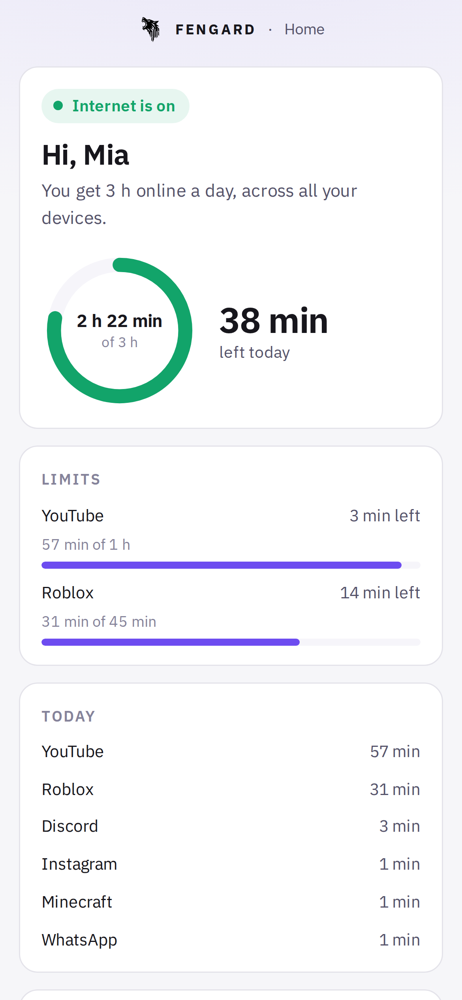<br><b>My time</b> at <code>fengard.lan/me</code>: what's used, what's left, and a "need more time?" button.</td>
    <td width="33%" align="center">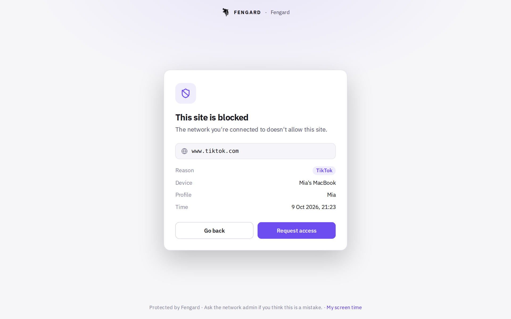<br><b>On a laptop</b> the same page, served over HTTP and HTTPS.</td>
  </tr>
</table>

<sub>Screenshots are from a simulated home network with demo devices and a month of generated history.</sub>

## How it works

Devices keep using the router for DNS as they always did. Fengard answers those lookups, and its rules in
the router's own nftables or iptables firewall make sure nothing gets around it: other DNS servers, DNS over
HTTPS, TLS or QUIC, and Tor are redirected or blocked in the kernel. If Fengard stops, the router's dnsmasq
takes DNS over and the house stays online. See [how it works](docs/how-it-works.md) for the design,
[performance](docs/how-it-works.md#performance) and [security](docs/how-it-works.md#security).

## Features

| Area | What it does |
|---|---|
| Devices | Found from DHCP and the neighbor table (IPv4 and IPv6; the ARP table on Windows and macOS), with the manufacturer from the MAC. Rename, group, pause, block, forget, Wake-on-LAN |
| Profiles | Blocked categories, 55 individual apps (TikTok, Roblox, Discord, Fortnite and more), SafeSearch, custom rules, schedules, pause |
| Categories | Ads, malware, adult, gambling, social, gaming, streaming, AI chatbots, VPN and DNS bypass, Tor. Updated daily |
| Screen time | Profiles marked as a person get a daily online limit and per-app or per-category limits (for example Fortnite 2 h a day), counted once across all their devices |
| My time page | `http://fengard.lan/me` on any of the person's devices: time used and left, each limit, what it went on, and a "need more time?" request the admin can grant from the alert |
| Bypass protection | Redirects all DNS to Fengard, blocks DoH, DoT and DoQ, turns off Firefox DoH and iCloud Private Relay |
| Tor | Blocked by name (Tor Browser, bridges) and by address: the relay list refreshes daily into a firewall set, applied per profile |
| Remote access VPN | Built-in WireGuard server. Add a phone, scan the QR code, and it gets the same filtering on mobile data. Detects double NAT and says what to forward |
| Tailscale | When no port can be forwarded, the router can be a Tailscale exit node. Fengard filters `tailscale0` like the LAN and lists Tailscale devices |
| Custom blocklists | Pick from popular lists (HaGeZi, OISD, AdGuard DNS filter, Steven Black and more) or subscribe to any hosts-file or domain list by URL, up to 16 |
| Check a site | What every profile would do with a domain and why, also from the command palette |
| Temporary allow | Allow a site for an hour, or any length, for one profile or everyone. One click from an access request |
| Pause protection | Turn all filtering off for a few minutes when something breaks. Device pauses still apply |
| Local DNS | Every device answers as `<name>.lan`, with custom A, AAAA and CNAME records and reverse lookups. `.lan` never leaks upstream |
| Upstreams | Plain, DNS-over-TLS and DNS-over-HTTPS (by name or IP), with an optional DNSSEC-record request (validation depends on the upstream) |
| DNS over HTTP/3 | One switch sends DoH over HTTP/3 with [fengard-h3](#dns-over-http3), Fengard's own small QUIC client. Falls back to HTTP/2 by itself when UDP is blocked |
| Block page | Branded, over HTTP and HTTPS (a per-router CA with signing restricted in software to blocked names and the dashboard), with an access-request form |
| Firewall | Port forwards, WAN hardening (service ports closed, SYN and ICMP limits, invalid packets dropped), per-device DNS flood limit, quarantine for new devices |
| Returning devices | Phones and laptops that rejoin with a new private Wi-Fi address are matched to the device they were, by DHCP name and fingerprint, the old address going quiet as the new one appears, and the sites they use. Sure matches keep their profile automatically, others are suggested on the Devices page. A copied name alone is never enough |
| DNS resilience | Cache, serve-stale when the upstream is down, merged duplicate lookups, per-device and global rate limits |
| Notifications | Discord, Slack, Telegram, ntfy and generic webhooks, by severity |
| Accounts | Admin and viewer roles, two-factor (TOTP and recovery codes), API keys, idle and absolute session timeouts |
| Dashboard HTTPS | Served with a CA-signed certificate for its names and IP, so installing the CA makes it green |
| Certificate portability | The CA exports, imports and travels in backups, so a replacement router keeps the trust already installed on devices |
| Admin | Audit log, config history with rollback, backup and restore |
| Updates | Checks GitHub for new releases, makes sure a release still supports this router's CPU, firmware and memory, then updates from the dashboard in about a minute or overnight on its own. A new version is test-run before it replaces the old one, and the old one comes back if it doesn't start |
| Monitoring | Live and historical activity per device, 24 h, 7 d and 30 d charts with comparison, top lists, alerts |
| Internet | A green bar with the line's speed, a speed test every night around 4 am (or any time from the dashboard), and an alert like "Internet was down 14 min" after an outage |
| Live activity | Live speed and data used per device, by day, week, month or any date range in the last year, read from the router's own connection table with no extra firewall rules |
| Who's home | Turn on arrival alerts for a phone and Fengard shows whether it's home and messages you when it arrives or leaves |
| Device check | Every week Fengard checks the devices on your network for risky open doors like Telnet, Android debugging on TV boxes, or a camera stream with no password, and for ports a device opened to the internet with UPnP, and explains each one in plain words |
| Captive portal | Optional. The first time a new iPhone or iPad joins, it shows a sign-in page saying the network is protected by Fengard, with a Join network button. You can swap in your own HTML and CSS (scripts never run). Computers and smart devices never see it, and anything that doesn't tap Join gets through after 10 minutes |

## Configuration reference

Command line flags, environment, files and the HTTP API are in the
[configuration reference](docs/configuration.md).

## Troubleshooting

| Problem | Fix |
|---|---|
| "Can't reach SSH on the router" | Turn on SSH in the router's settings. OpenWrt: **System → Administration → SSH Access**. GL.iNet has it on by default |
| "Router has a new identity" | The router was reset or replaced. Answer yes when the installer asks to forget the old one |
| "Not enough free storage" | Use USB storage with `FG_DIR=/mnt/<usb>/fengard`, or a router with more flash |
| "AdGuard Home is using DNS port 53" | Run the installer again and answer yes, or set `ADGUARD=off`. It comes back on when Fengard is removed |
| "Another program uses DNS port 53" | Turn off unbound or similar in the router's settings and run the installer again |
| Blocklists show only a few hundred domains | The router has no internet yet. Lists download as soon as it does |
| VPN page says WireGuard isn't installed | Install the `kmod-wireguard` and `wireguard-tools` packages. Everything else works without them |
| Phones show "no internet" on Wi-Fi | Check that devices get the router as their DNS server. The installer sets DHCP option 6 for every LAN network |
| Tailscale on a phone or laptop stops working | The "VPN, proxy & DNS bypass" category blocks `tailscale.com`. Add an allow rule for `tailscale.com` under **Filtering → Network-wide rules**. Tailscale on the router itself always works |
| Something is wrongly blocked | Use **Check a site**, then add an allow rule or a temporary allow. **Pause protection** turns filtering off for a few minutes |

## FAQ

**Is Fengard a Pi-hole or AdGuard Home alternative?**
Yes. It blocks ads, trackers and malware for the whole network like they do, and adds per-person screen
time, app blocking, a block page and firewall enforcement. See [How it compares](#how-it-compares).

**Can kids get around it with DNS-over-HTTPS, a VPN or a different DNS server?**
Changing DNS doesn't help: all lookups are redirected back to Fengard, and DoH, DoT, DoQ and Tor are blocked
in the router's firewall. Known VPN and proxy services are blocked by the "VPN, proxy & DNS bypass" category.
No filter catches every VPN, so for younger kids pair it with a schedule or a device pause.

**What about phones with private (random) Wi-Fi addresses?**
Most phones keep one private address per network, so they stay the same device. When one does change
(iOS "Rotating", forgetting the network), Fengard recognizes it from its DHCP name and fingerprint, the old
address going quiet at the same moment, and the sites it uses, and puts it back in its own profile. Guesses
it isn't sure about wait for you on the Devices page, and **Same device as…** links any two by hand. Two
devices online at once are never merged, and copying a name isn't enough to get someone else's profile.

<a id="dns-over-http3"></a>
**Does Fengard do DNS over HTTP/3?**
Yes. Turn on **DNS → Use HTTP/3** and pick a DoH upstream (Cloudflare, Google, Quad9 and AdGuard all
work). It's done by [fengard-h3](internal/fengard-h3), a QUIC and HTTP/3 client written for Fengard that
only does what DNS needs, so it adds about 0.1 to 0.3 MB to the program instead of the several MB a general
purpose QUIC library would. The TLS 1.3 handshake comes from Go's standard library. With the switch off it
uses no memory at all, and if UDP is blocked on the way Fengard goes back to HTTP/2 by itself and tries
HTTP/3 again later. The DNS page shows which one each upstream is using.

Against [quic-go](https://github.com/quic-go/quic-go)'s HTTP/3 client with its default settings, on the same
server ([`dev/h3lab`](dev/h3lab), `go test -bench Vs`):

| | fengard-h3 | quic-go |
|---|---|---|
| Lookup on an open connection | 415 µs | 477 µs |
| CPU per lookup, 64 at a time | 60 µs | 124 µs |
| First lookup on a new connection | 2.65 ms | 2.86 ms |
| Memory an open connection holds | 104 KB | 190 KB |
| Memory allocated per lookup | 1.2 KB | 15.5 KB |
| Lookup after a quiet spell longer than the server's idle timeout | 0.9 ms | 5 s, first try fails |

fengard-h3 pings a connection that's been used in the last five minutes before the server would drop it,
connects as soon as HTTP/3 is switched on, and resumes the TLS session when it does have to reconnect.

**Do I have to flash my router?**
No. If it already runs OpenWrt or GL.iNet firmware, Fengard installs next to it and uninstalls cleanly.
If it runs stock firmware that isn't OpenWrt-based, use computer mode or flash OpenWrt.

**Does it work on GL.iNet routers?**
Yes. GL.iNet firmware is OpenWrt-based, and Fengard is used daily on a GL-MT3000 (Beryl AX). The installer
handles GL.iNet's own web server and firewall setup.

**How should I set up the router's DNS before installing?**
Leave it as it is. If AdGuard Home is on, the installer offers to turn it off, since Fengard does the
filtering and AdGuard Home would only take up memory, and removing Fengard turns it back on. After that,
pick your DNS servers on Fengard's **DNS** page. The router's own DNS settings no longer matter, and changing
them later doesn't break anything.

**Will it slow my internet down?**
No. Only DNS lookups go through Fengard, answered in milliseconds and mostly from cache. Everything else is
plain kernel routing. It uses about 25 MB of memory.

**Can it brick my router, or take the internet down?**
It doesn't touch the firmware or bootloader, so there's nothing to brick, and uninstall puts everything back.
For the internet, the installer never moves DNS until Fengard is set to start at boot, and a watchdog hands
DNS to the router's own dnsmasq if Fengard ever stops answering. Both are tested in the
[router lab](docs/routers.md#supported-routers), including a power cut mid-install and a firmware upgrade.

**How do updates work?**
Fengard checks GitHub twice a day. When a new release is out, it reads the release's list of supported CPUs,
the oldest OpenWrt it runs on and the memory it needs, and only offers it if this router qualifies. You get
an alert and a banner with **Update now**. It downloads the update, checks its checksum, test-runs it on a
private port and only then swaps it in. If the new version doesn't answer DNS, the old one comes back on
its own. Turn on **Settings → Install updates automatically** to have this happen overnight, between 3 and 5 am.

**Can I go back to an older version?**
Yes, from 1.3.1.2. **Settings → Updates → Go back…** lists older releases back to 1.3.0. Going back gets the same
checks as an update, your settings are backed up first, and automatic updates then skip the version you
left until something newer comes out.

**What are preview builds?**
Pre-releases with a fourth number, like 1.3.1.1, that come out between full releases so new things can be
tried early. They go through the same router lab and tests. Nobody gets one unless they turn on
**Settings → Updates → Preview builds** (from 1.3.1), and a preview you're on is replaced by the next full
release once that's out.

**Is it free?**
Yes. Fengard is open source under the Apache 2.0 license, with no accounts, cloud or subscription.
Everything stays on your router.

## Development

Building, testing, the router and network labs and how releases are made are in
[docs/development.md](docs/development.md), with a [project layout](docs/development.md#project-layout).

## Contributing

Router test reports are the most useful thing right now: if you try Fengard on a router, please
[tell us how it went](https://github.com/masaleem-oss/Fengard/issues/new?template=router_report.yml).
Bug reports and pull requests are welcome too, see [CONTRIBUTING.md](CONTRIBUTING.md).
What changed in each release is in [CHANGELOG.md](CHANGELOG.md).

## License

Fengard is licensed under the [Apache License 2.0](LICENSE). Third-party components are listed in [NOTICE](NOTICE):
IBM Plex Sans and Mono (OFL), Lucide icons (ISC), Simple Icons logos (CC0), qrcode-generator (MIT) and the
IEEE MA-L vendor registry, all bundled so the dashboard works offline. Blocklists aren't distributed with
Fengard; each installation downloads them from their publishers under the publishers' licenses.

## Star goals

What gets built next as the repo grows. Fixes and new router support keep coming either way.

| Stars | Goal |
|---:|---|
| 50 | **Full IPv6 and small routers.** IPv6 filtering and bypass blocking, installing to a USB drive (extroot) for routers with little flash, and a low-memory mode for 128 MB routers |
| 100 | **Encrypted DNS for your own devices.** Fengard serves DoH and DoT itself, so Android Private DNS and an iOS profile point straight at the router and get the same filtering on mobile data, no VPN needed |
| 150 | **Bandwidth control.** Speed limits per profile or device, priority for games and video calls, and a bufferbloat fix (CAKE) with a before and after test |
| 200 | **Official packages and a ready image.** Fengard in the OpenWrt package feeds, and an image for Raspberry Pi and x86 mini PCs you flash and plug in |

<p align="center"><sub>Made by <a href="https://github.com/masaleem-oss">masaleem-oss</a></sub></p>
