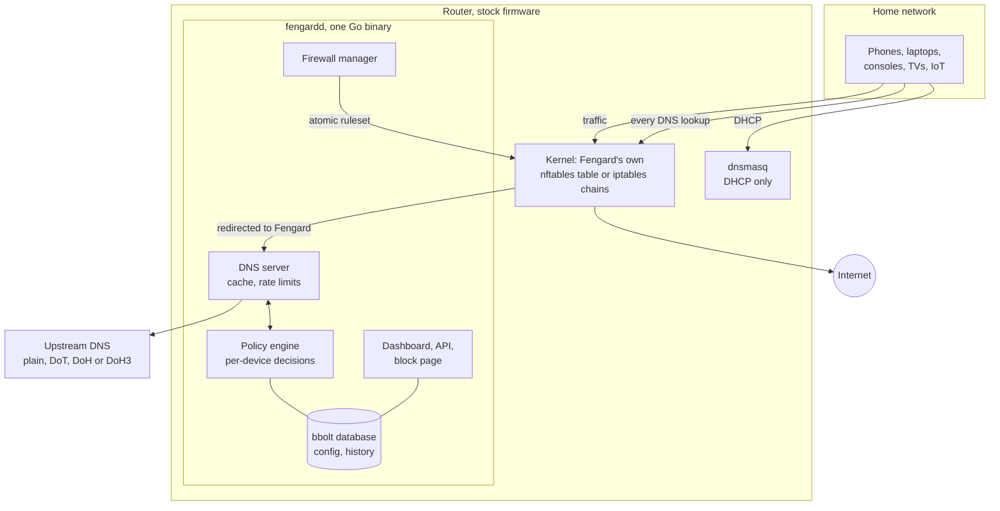
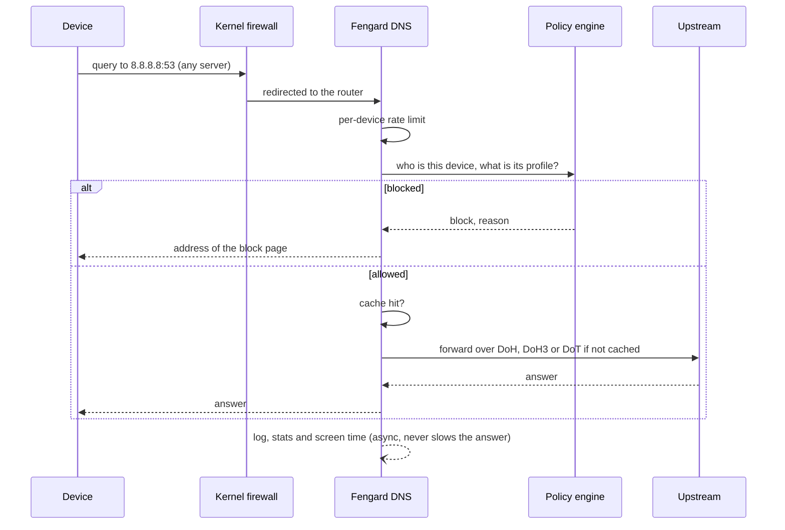
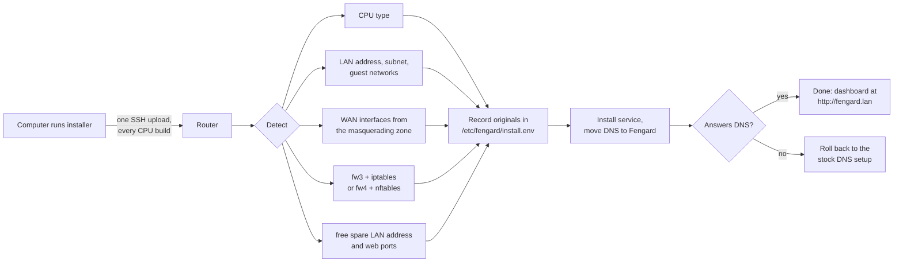

# How Fengard works

[← Back to the README](../README.md)

## How it works

A lookup's journey:

The policy engine checks each lookup in this order and stops at the first match:

```mermaid
flowchart LR
    A[New device<br/>not approved?] --> B[Device or<br/>profile paused?]
    B --> C[Protection<br/>paused?]
    C --> D[Daily screen<br/>time used up?]
    D --> E[App time<br/>limit reached?]
    E --> F[Schedule<br/>active?]
    F --> G[Allow rule?]
    G --> H[Temporary<br/>allow?]
    H --> I[Block rule?]
    I --> J[Blocked<br/>category?]
    J --> K[Blocked app?]
    K --> L[Custom<br/>blocklist?]
    L --> M[SafeSearch<br/>rewrite?]
    M --> N[Allow]
```

Design choices:

- **The kernel does the heavy lifting.** Packet filtering, NAT, port forwards and flood limits are rules in
  Fengard's own table or chains next to the router's normal firewall. Two backends, nftables (OpenWrt 22 and
  newer, modern Linux) and iptables (OpenWrt 21, GL.iNet 4.x), picked automatically. Rules are applied
  atomically and removed when Fengard stops.
- **Bounded everything.** The DNS cache, rate-limiter keys, stats, certificate cache, device tracking and
  notification queues all have hard caps, so floods of random names or addresses can't grow memory.
- **DNS never waits on slow work.** Query logging, notifications and device discovery are asynchronous and
  drop (and count) rather than slow a lookup down.
- **Compact blocklists.** About 535k domains take about 11 MB: a sorted blob with a one-byte length per domain
  and a small table of category masks instead of a Go map, built in fixed blocks so loading doesn't spike.
- **No build step, no framework.** The dashboard is plain ES modules and CSS embedded in the binary, served
  with ETags and gzip. A first visit downloads about 90 KB, and it works with no internet access.
- **Nothing to install on the router.** One static binary with its own root certificates, so it works even on
  firmware without a CA bundle.

## What the installer changes

Everything is read from the router's own configuration, so nothing is hardcoded to one model:

| What | Change | Undone by uninstall |
|---|---|---|
| `/usr/bin/fengardd` | the program, only the one built for this CPU | yes |
| `/etc/fengard/` | settings, database, certificates, blocklists | kept unless `--purge` |
| `/etc/init.d/fengard` | the service; adds one spare LAN address for the dashboard and block page, and runs a small watchdog | yes |
| dnsmasq | stops answering DNS and keeps doing DHCP; devices are told to use the router for DNS | restored exactly |
| firewall | a hook that re-applies Fengard's rules after a firewall reload, plus the VPN interface and port | yes |
| `/etc/sysupgrade.conf` | keeps Fengard across firmware upgrades | yes |

Most firmware keeps its own web interface on ports 80 and 443, so Fengard listens on free ports and the
firewall redirects the spare address's 80 and 443 to them. If any step fails the installer rolls back on its
own, and it never switches DNS over until Fengard is set to start at boot, so even a power cut mid-install
can't leave the household without DNS. Reinstalling keeps the same address, ports and certificate.

**The house stays online if Fengard doesn't.** The watchdog checks Fengard every 20 seconds. If it's stopped,
crashing or missing (say USB storage didn't mount), plain dnsmasq takes over DNS within about a minute and a
half. Every 10 minutes the watchdog gives Fengard the port back, and as soon as Fengard answers again, it's in
charge. Filtering is off while dnsmasq stands in, but nobody loses internet.

Optional settings for the router installer:

| Variable | Use |
|---|---|
| `FG_IP=192.168.1.2` | choose the spare LAN address yourself |
| `LAN_NET=lan` | the main LAN network name in `/etc/config/network` |
| `FG_DIR=/mnt/usb/fengard` | keep data and the program on USB storage |
| `FORCE=1` | install even if the router looks too small |
| `ADGUARD=off` | turn AdGuard Home off without asking if it's using port 53 (it comes back on when Fengard is removed) |

## Performance

Measured on the network lab ([`dev/netlab.sh`](../dev/netlab.sh)) with both firewall backends:

| Measure | Result |
|---|---|
| Memory | 22 to 26 MB RSS |
| Idle CPU | 0 ms over 20 s |
| Cost per query under sustained load | about 16 µs |
| A busy home at about 20 queries per second | about 0.03% of one core |
| One device flooding 1.4 million queries per second | dropped in the kernel; other devices keep resolving with 0 failures and single-digit-ms latency |
| Blocklists | about 535k domains in about 11 MB |

## Security

- **Accounts.** Passwords are hashed with bcrypt. Two-factor uses TOTP with recovery codes. Sessions have
  idle and absolute timeouts, and login attempts are rate limited.
- **CSRF.** Every write needs a custom header that browsers won't send cross-origin, and the Origin is checked.
- **Dashboard transport.** The dashboard works over HTTP from your own network (private, link-local and
  Tailscale addresses) and over HTTPS from anywhere. Anything else gets a page pointing at the HTTPS address.
  Turn on **Settings → Account → Require HTTPS** to stop plain HTTP on the LAN too. It can only be switched
  on from an HTTPS session, so you can't lock yourself out. Session cookies set over HTTPS are Secure,
  HttpOnly and SameSite Strict. To check the CA before installing it, compare its SHA-256 fingerprint with
  `logread -e 'CA SHA-256'` over SSH.
- **Certificates.** Each router makes its own CA. Fengard restricts signing in software to blocked names and
  the dashboard. Installing this root trusts its private key for any website, so protect the router and CA
  exports. New versions store the key and certificate together in `ca.bundle` (mode 0600). Existing `ca.crt`
  and `ca.key` files are migrated without changing trust and retained for older binaries. After importing a
  different CA, rolling back to an older binary uses the previous legacy identity and requires restoring that
  identity on clients. Include `ca.bundle` in filesystem backups; the dashboard CA export remains portable.
- **DNSSEC.** The DNSSEC setting sends the DO bit to request DNSSEC records. Fengard does not validate
  signatures locally. Validation depends on a trusted validating upstream; use authenticated DoH or DoT
  transport. Plain DNS and an untrusted upstream do not establish validation assurance.
- **History storage.** Detailed queries retain at most 10,000 records and 4 MiB of serialized records by
  default, with the oldest removed transactionally. Audit and alert logs each retain at most 2,000 records and
  512 KiB. Time retention still applies and these budgets can shorten it. Override query budgets with
  `-query-log-records` and `-query-log-mb`. Detailed log writes suspend near the database high-water threshold
  (`-log-file-mb`, default 16 MiB) or free-space reserve (`-log-space-reserve-mb`, default 4 MiB), while aggregate
  counters and critical writes continue. The threshold is an admission guard, not a filesystem quota: bbolt
  pages, transaction overhead and concurrent filesystem activity affect actual allocation. Query stats expose
  `droppedWrites` and `evictedRecords`; alert responses expose dropped counts. Deleting records reuses pages
  but does not shrink an existing database. Back up and compact an oversized legacy database offline with
  enough temporary space; never delete it to recover space because it also contains account and usage state.
- **Kernel enforcement.** Bypass blocking, quarantine and flood limits are firewall rules, so they hold even
  while Fengard is busy.

If you find a security issue, please report it privately through
[GitHub security advisories](https://github.com/masaleem-oss/Fengard/security/advisories/new) rather than an issue.
